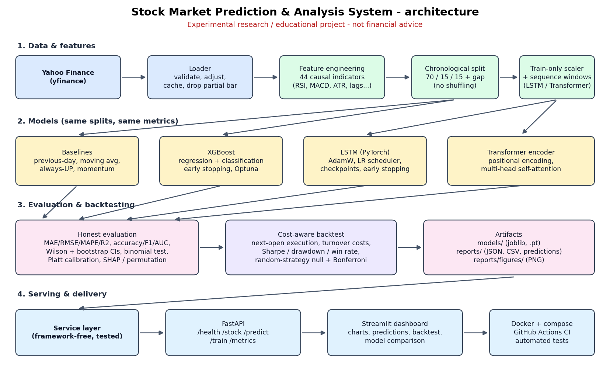
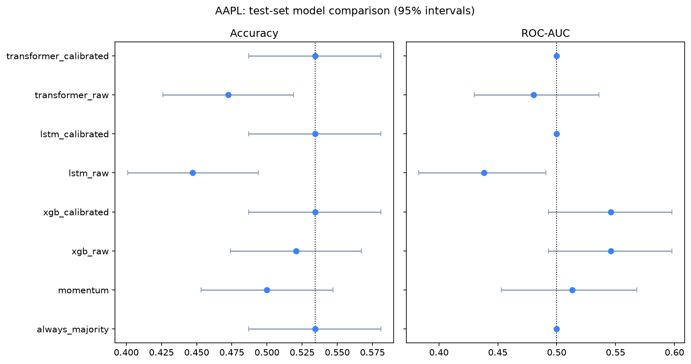
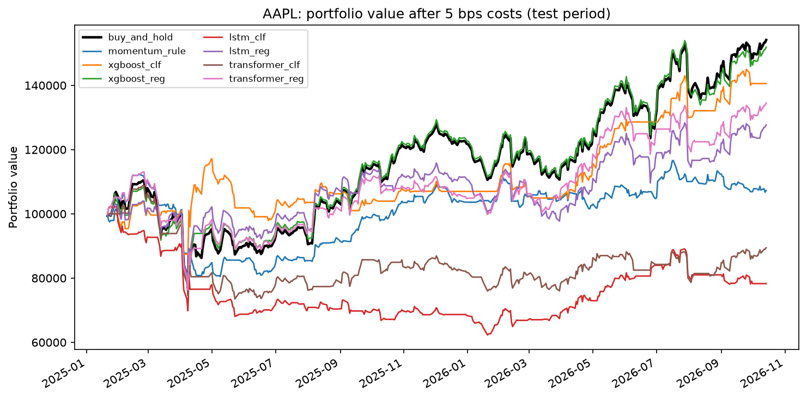
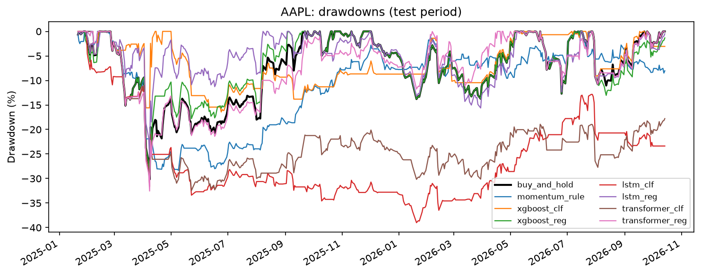
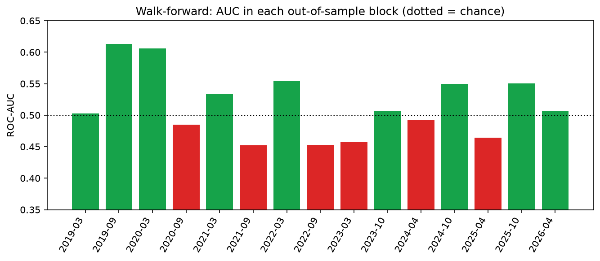
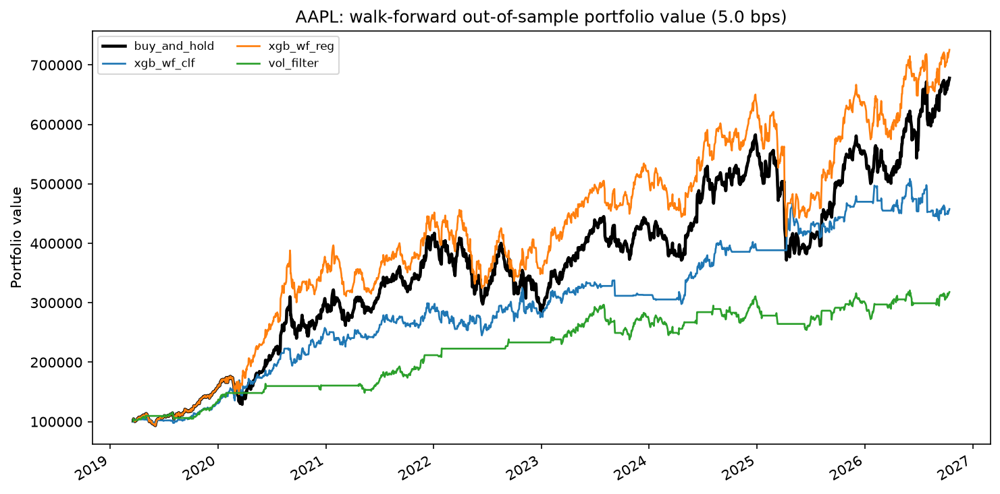
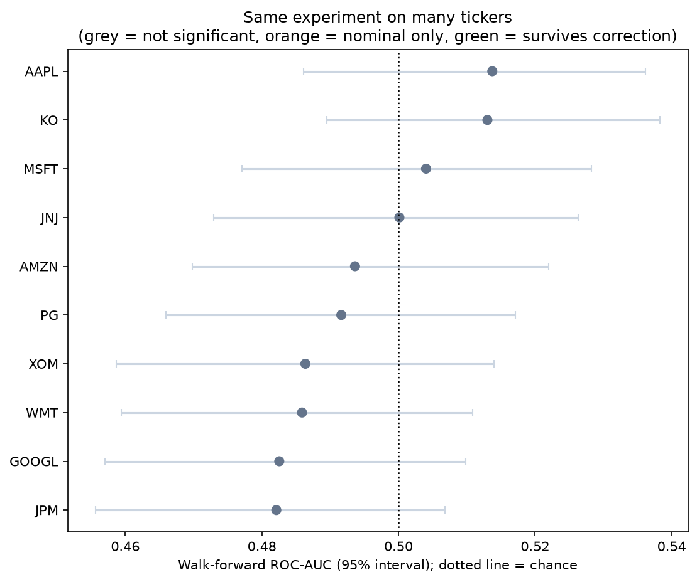
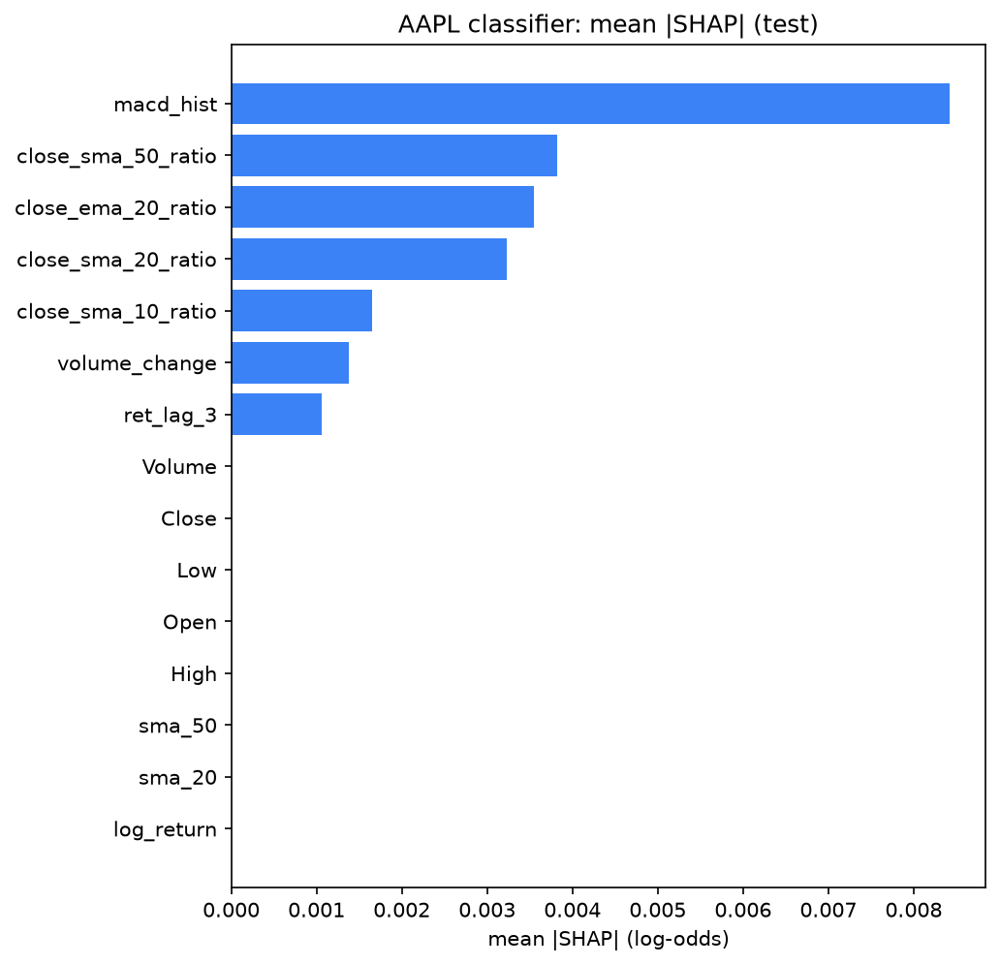
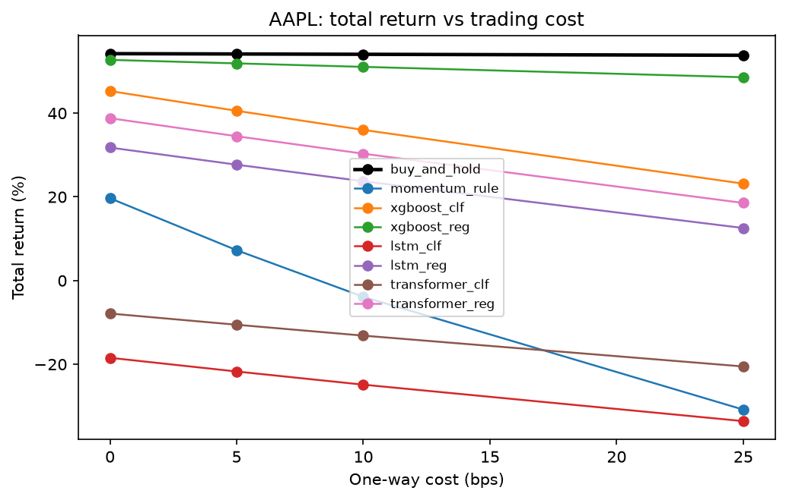

# Stock Market Prediction & Analysis System

[](https://github.com/tnithin236/stock-market-ai/actions/workflows/ci.yml)

An end-to-end, production-style machine-learning project that forecasts next-day stock movement with **baselines, XGBoost, an LSTM and a Transformer**, evaluates them with leakage-safe time-series methodology and statistical significance tests, backtests the resulting signals with trading costs, and serves everything through a **FastAPI** backend, a **Streamlit** dashboard, **Docker** and **GitHub Actions CI**.

> **Disclaimer - experimental research and educational project. This is NOT financial advice.**
> It cannot reliably predict markets and does not generate guaranteed profits. In this project's held-out tests **no model showed a statistically significant edge** over simple baselines (details below). Do not trade on its output.




## Key findings (AAPL, held-out test period 2025-01-17 to 2026-10-13, 436 trading days)

* **No statistically significant predictive edge.** The best classifier (XGBoost) reached test ROC-AUC 0.546 with a 95% interval of [0.493, 0.598], which includes 0.5 (chance). No model beat the always-UP baseline with p < 0.05.
* **Regression models only learned the average drift.** RMSE relative to a "tomorrow = today" forecast was 1.0019 (XGBoost), 1.0029 (LSTM) and 1.0052 (Transformer); none was below 1.0.
* **More complex did not mean better.** Out-of-sample error rose slightly from XGBoost to LSTM to Transformer, the pattern expected when extra capacity fits noise.
* **The backtest agrees.** After 5 bps costs, buy-and-hold returned +54.1% (Sharpe 0.99). The best ML strategy (XGBoost classifier) returned +40.6% (Sharpe 0.94) while invested only half the time, and was indistinguishable from random strategies with the same exposure (p = 0.16; Bonferroni-corrected p = 1.0). The LSTM and Transformer classifiers lost money (-21.7%, -10.6%).
* **Walk-forward validation agrees.** Re-training every 6 months across 15 out-of-sample blocks (1,890 days, 2019-2026) gave a pooled AUC of 0.514 (95% interval [0.487, 0.538]), above 0.5 in only 9 of 15 blocks (sign-test p = 0.30). The whole pooled edge comes from two consecutive 2020 blocks (AUC about 0.61 each); the other 13 average about 0.50.
* **Apparent backtest gains are not directional skill.** A direction-free rule ("hold only when 20-day volatility is below its historical median") reached a higher Sharpe (1.11) than the best ML classifier (1.04) with a similar drawdown, and no strategy is significant after correcting for the number of strategies tried.
* **It is not just AAPL.** The same walk-forward experiment on 10 liquid US stocks gave a mean AUC of 0.495; 0 of 10 were significant at 0.05 (about 0.5 would be expected by chance alone), and 0 after Holm-Bonferroni or FDR correction. The ML long/flat strategy had a higher Sharpe than buy-and-hold on only 1 of 10 tickers (AAPL, the one examined most).
* **The value of the project is the methodology**: leakage prevention, honest evaluation, significance testing and a reproducible, tested, deployable system - not a trading edge.

## Problem statement

Given daily OHLCV data, can machine-learning models predict (1) the **next trading day's closing price** (regression) and (2) whether it will **rise or fall** (classification) better than naive baselines - and would acting on those predictions have survived realistic trading costs? Financial time series are noisy, non-stationary and easy to over-fit or leak information into, so the project's emphasis is on evaluating honestly.

## Data

* **Source:** Yahoo Finance via `yfinance` (split/dividend-adjusted OHLCV). Any ticker is supported; AAPL is the worked example.
* **Snapshot used for the reported results:** AAPL, 2015-01-02 to 2026-10-14 (2,963 trading days; 2,913 usable rows after indicator warm-up). The end date is frozen in `configs/config.yaml` so every run is reproducible.
* **Validation:** the loader drops NaN rows, non-positive prices and impossible highs/lows, caches downloads, and **drops an incomplete current-day bar** (a partial bar is a subtle look-ahead problem).

| Split | Rows | Period | Up days |
|---|---|---|---|
| Train | 2,039 | 2015-03-16 to 2023-04-19 | 52.5% |
| Validation | 436 | 2023-04-21 to 2025-01-15 | 55.1% |
| Test | 436 | 2025-01-17 to 2026-10-13 | 53.4% |

The split is **chronological (never shuffled)**, with a one-row gap between sets because the label of day *t* is day *t+1*'s price.

## Feature engineering

44 model inputs (22 scale-free ones used by default for the neural networks), all **causal** (row *t* uses only data up to day *t*; a test proves it by recomputing features on truncated history). Full descriptions: [`docs/FEATURES.md`](docs/FEATURES.md).

| Group | Features |
|---|---|
| Returns | daily and log returns |
| Trend | SMA/EMA 10/20/50 and the close's distance from each |
| Momentum | RSI(14), MACD (line, signal, histogram), 5/10-day momentum |
| Volatility | Bollinger bands (%B, width), ATR(14) and ATR%, rolling 10/20-day volatility |
| Volume | volume change, volume vs 20-day average |
| Lags | lagged prices and returns (1, 2, 3, 5 days) |

## Models

| Model | Notes |
|---|---|
| Baselines | previous-day price, SMA(10/20) forecast, always-UP (majority), momentum, mean reversion |
| XGBoost | regression on next-day *return* (converted to price) and classification; early stopping on validation; optional Optuna tuning; class weighting; Platt calibration; gain importance and SHAP |
| LSTM (PyTorch) | 30-day windows, train-only scaling, AdamW, `ReduceLROnPlateau`, gradient clipping, early stopping, best-checkpoint restore, Huber loss (regression) / weighted BCE (classification), optional Optuna tuning, permutation importance |
| Transformer (PyTorch) | linear embedding, sinusoidal positional encoding, pre-norm encoder blocks with multi-head self-attention, same trainer and evaluation as the LSTM. Notes on why attention can capture longer-range dependencies - and why that did not help here - in [`docs/TRANSFORMER_NOTES.md`](docs/TRANSFORMER_NOTES.md) |

## Evaluation methodology

| Risk | What the project does |
|---|---|
| Random-split leakage | chronological train / validation / test with a gap; automated audit that fails if the sets overlap in time |
| Look-ahead in features | indicators use backward-looking windows only; tests recompute on truncated history and with altered future prices |
| Scaling leakage | scaler fitted on **training rows only**; tests verify the statistics and that changing test-period data cannot change training sequences |
| Look-ahead in backtests | signal at the close of day *t*, trade at the **open of day t+1**; tests prove changing a future position never changes an earlier return |
| Tuning leakage | early stopping, feature-set choice, hyperparameter search and calibration use **validation only**; the test set is evaluated once |
| Over-reading noise | Wilson intervals for accuracy, bootstrap intervals for AUC, binomial test vs the majority baseline, random-strategy null test, Bonferroni correction |
| Misleading metrics | price R-squared is ~0.99 for almost anything because prices trend, so models are judged by RMSE relative to the previous-day forecast and by out-of-sample R-squared on *returns* |
| Class imbalance | accuracy is compared with the always-UP baseline; precision, recall, F1, balanced accuracy, MCC and ROC-AUC are reported |
| Calibration | Platt scaling on validation; if the learned slope is not positive it is **not allowed to flip the score's direction** (falls back to the base rate) |
| Reproducibility | frozen data end date, fixed seeds, recorded test periods, a warning if result files come from different snapshots |

## Results (test period)

**Regression - next-day close.** `RMSE_vs_naive` below 1.0 and `oosR2_ret` above 0 would indicate an edge.

| Model | RMSE | RMSE vs previous-day | Out-of-sample R2 on returns |
|---|---|---|---|
| Previous-day (naive) | 4.5532 | 1.0000 | 0.0000 |
| XGBoost | 4.5620 | 1.0019 | 0.0003 |
| LSTM | 4.5663 | 1.0029 | -0.0014 |
| Transformer | 4.5767 | 1.0052 | -0.0088 |

**Classification - next-day direction.**

| Model | Accuracy (95% CI) | p vs always-UP | ROC-AUC (95% CI) |
|---|---|---|---|
| Always UP | 0.534 [0.487, 0.581] | - | 0.500 |
| Momentum rule | 0.500 [0.453, 0.547] | 0.93 | 0.513 [0.453, 0.568] |
| XGBoost | 0.521 [0.474, 0.567] | 0.73 | 0.546 [0.493, 0.598] |
| LSTM | 0.447 [0.401, 0.494] | 1.00 | 0.438 [0.383, 0.491] |
| Transformer | 0.473 [0.426, 0.519] | 1.00 | 0.480 [0.430, 0.536] |

Calibrated LSTM/Transformer scores collapse to a constant (their raw scores had no usable positive signal on validation), which is the intended behaviour of the calibration safeguard. Training curves show validation loss bottoming within the first few epochs for every neural model, i.e. rapid overfitting.



## Backtesting

* **Setup:** $100,000 start, long/flat, one-way cost of 5 bps on turnover, signal at the close and trade at the next open (overnight gap earned by the old position, intraday move by the new one), compounding done exactly.
* **Metrics:** total return, CAGR, volatility, Sharpe, Sortino, max drawdown, Calmar, daily and per-trade win rate, exposure, turnover, cost drag.
* **Is it luck?** each strategy is compared with 1,000 random strategies of the same average exposure; p-values are Bonferroni-corrected for the number of strategies tried.

| Strategy | Return | Sharpe | Max drawdown | Trades | Exposure |
|---|---|---|---|---|---|
| Buy-and-hold | +54.1% | 0.99 | -30.2% | 1 | 100% |
| XGBoost classifier | +40.6% | 0.94 | -16.4% | 33 | 50% |
| XGBoost regressor | +51.9% | 0.95 | -30.2% | 6 | 97% |
| LSTM regressor | +27.7% | 0.63 | -25.6% | 32 | 84% |
| Transformer regressor | +34.5% | 0.75 | -32.6% | 32 | 81% |
| Momentum rule | +7.3% | 0.31 | -28.4% | 110 | 53% |
| Transformer classifier | -10.6% | -0.12 | -32.5% | 30 | 70% |
| LSTM classifier | -21.7% | -0.46 | -39.0% | 41 | 55% |

Costs decide high-turnover strategies: the momentum rule loses 10.95% of capital to costs (+19.7% at 0 bps, -30.8% at 25 bps). The XGBoost classifier's lower drawdown mostly reflects being out of the market half the time; it beats 84% of random strategies with the same exposure (p = 0.16, corrected p = 1.0), i.e. not distinguishable from luck. The test window is a single ~21-month bull market, a limitation noted below.




## Walk-forward validation (XGBoost)

A single test window can look better or worse than reality, so XGBoost (default parameters, no tuning) was also evaluated with an **expanding-window walk-forward**: train on everything before a block (the last 15% of that window, in time order, is used for early stopping), predict the next 126 trading days, then roll forward and retrain. This gives **15 out-of-sample blocks and 1,890 days (2019-03-19 to 2026-10-13)** across the 2020 crash, the 2022 bear market and the recent rally.

| Measure | Result |
|---|---|
| Pooled accuracy | 0.514 [0.491, 0.536] vs always-UP 0.534 [0.512, 0.557] (p = 0.97) |
| Pooled ROC-AUC | 0.514 [0.487, 0.538] |
| Blocks with AUC > 0.5 | 9 of 15 (sign-test p = 0.30), mean block AUC 0.515 |
| AUC excluding the two 2020 blocks | about 0.50 (the two 2020 blocks scored about 0.61 each) |
| RMSE vs previous-day forecast | 1.0018 (out-of-sample R-squared on returns 0.0013) |



**Pooled walk-forward backtest** ($100,000, 5 bps, signal at the close, trade at the next open):

| Strategy | Return | CAGR | Sharpe | Max drawdown | Trades | Exposure |
|---|---|---|---|---|---|---|
| Buy-and-hold | +577.9% | 29.1% | 1.00 | -36.2% | 1 | 100% |
| XGBoost classifier | +357.7% | 22.5% | 1.04 | -18.1% | 332 | 48% |
| XGBoost regressor | +625.6% | 30.2% | 1.10 | -36.7% | 101 | 90% |
| Direction-free volatility filter | +218.1% | 16.7% | 1.11 | -19.7% | 54 | 43% |

**What the diagnostics show.**

* The **volatility filter** has no model and no direction signal, yet matches or beats the ML strategies' Sharpe and drawdown. It sits out turbulent periods (average annualised volatility 18% when long vs 34% when flat).
* The **classifier does not** show that pattern (28.6% when long vs 26.6% when flat), so volatility timing does not explain its result; its benefit is concentrated in the 2020 blocks and is not robust. Its 332 trades cost 33% of capital over the period, which is why its total return trails buy-and-hold.
* The **regressor** is mostly long (90%) and avoids high-volatility days (26.5% when long vs 36.5% when flat): de-risking, not direction prediction.
* **Luck tests.** An i.i.d. random-position null flatters any strategy that trades less, so a stricter **shifted-position null** is also used (the strategy's own positions circularly shifted: same exposure, same trades and costs, alignment broken). Even the model-free volatility filter passes it (p = 0.024), showing that "better than luck" is not evidence of directional skill. After Bonferroni correction for the three strategies compared, no p-value is below 0.05 (0.075, 0.18, 0.072), and many more strategies were examined across the project, which weakens any claim further.



## Robustness across tickers (XGBoost walk-forward)

Everything above is AAPL, the ticker examined most, so the same walk-forward experiment (15 retrained blocks, 1,890 out-of-sample days each, default parameters, no tuning) was repeated on **10 liquid US stocks**. With ten tickers and alpha = 0.05, about 0.5 "significant" results are expected by luck alone.

| Ticker | AUC (95% CI) | Blocks with AUC > 0.5 | Strategy Sharpe | Buy-and-hold Sharpe | Strategy return | Buy-and-hold return |
|---|---|---|---|---|---|---|
| AAPL | 0.514 [0.486, 0.536] | 9 / 15 | 1.04 | 1.00 | +358% | +578% |
| MSFT | 0.504 [0.477, 0.528] | 9 / 15 | 0.52 | 0.82 | +93% | +335% |
| AMZN | 0.494 [0.470, 0.522] | 8 / 15 | 0.40 | 0.55 | +70% | +164% |
| GOOGL | 0.483 [0.457, 0.510] | 8 / 15 | 0.71 | 0.90 | +166% | +469% |
| JPM | 0.482 [0.456, 0.507] | 9 / 15 | 0.35 | 0.74 | +49% | +265% |
| XOM | 0.486 [0.459, 0.514] | 7 / 15 | 0.15 | 0.61 | +6% | +189% |
| JNJ | 0.500 [0.473, 0.526] | 8 / 15 | -0.30 | 0.71 | -31% | +143% |
| WMT | 0.486 [0.459, 0.511] | 6 / 15 | 0.38 | 0.88 | +42% | +262% |
| KO | 0.513 [0.490, 0.538] | 11 / 15 | 0.33 | 0.82 | +33% | +189% |
| PG | 0.492 [0.466, 0.517] | 8 / 15 | -0.31 | 0.58 | -36% | +105% |

* **Mean AUC 0.495** (range 0.482 to 0.514); above 0.5 on 4 of 10 tickers (sign-test p = 0.83).
* **0 of 10 significant at 0.05** (about 0.5 expected by chance); **0 after Holm-Bonferroni** and **0 after Benjamini-Hochberg**. The best ticker, KO, had AUC 0.513 and beat 0.5 in 11 of 15 blocks (sign-test p = 0.059), which does not survive correction.
* **The strategy beat buy-and-hold's Sharpe on 1 of 10 tickers** (AAPL) and lagged on total return on all 10; on JNJ and PG it lost money while the stocks rose. AAPL being the lone exception is a reminder of selection effects: it is the ticker examined most.
* **Price forecasts:** RMSE relative to the previous-day forecast was 1.0 or worse on 8 of 10 tickers, and the two exceptions (AAPL 0.9994, PG 0.9927) are within what chance produces among ten.



Caveats: all ten are US large caps that survived to today (survivorship bias) and move together, so they are not ten independent experiments; the corrections therefore assume slightly more independence than there is.

## Screenshots

| Dashboard: prediction tab | Dashboard: backtest tab |
|---|---|
| ![Prediction]
| ![Backtest] |

| XGBoost feature importance (SHAP) | Cost sensitivity |
|---|---|
|  |  |

## Installation

Requires Python 3.10-3.12.

```bash
git clone https://github.com/tnithin236/stock-market-ai.git
cd stock-market-ai
python -m venv .venv
source .venv/bin/activate            # Windows PowerShell: .venv\Scripts\Activate.ps1
pip install -r requirements.txt
python -m pytest                     # optional: run the test suite
```

## Usage

```bash
python main.py eda --ticker AAPL        # exploratory analysis + interactive charts
python main.py features                 # leakage-safe feature table
python main.py baseline                 # chronological split + naive baselines
python main.py xgboost [--tune]         # train + evaluate XGBoost (saves models, reports, predictions)
python main.py lstm [--tune]            # LSTM
python main.py transformer [--tune]     # Transformer
python main.py compare                  # side-by-side test-period comparison + significance verdict
python main.py backtest [--cost-bps 5]  # cost-aware backtest vs buy-and-hold
python main.py walkforward              # expanding-window walk-forward validation + diagnostics
python main.py multiticker              # the same walk-forward study on 10 tickers with multiple-testing correction
uvicorn api.main:app --reload           # API   -> http://127.0.0.1:8000/docs
streamlit run app/streamlit_app.py      # UI    -> http://localhost:8501
```

All outputs are written to `models/`, `reports/` and `reports/figures/`. Hyperparameters live in `configs/config.yaml`.

## API

Interactive docs at `/docs`. Reference: [`docs/API.md`](docs/API.md).

| Method | Path | Purpose |
|---|---|---|
| GET | `/health` | status, version, which models exist per ticker |
| GET | `/stock/{ticker}?days=30` | recent OHLCV, period return, volatility |
| POST | `/predict` | next-session UP/DOWN and predicted close; body `{"ticker":"AAPL","model":"xgboost"}` |
| POST | `/train` | starts background XGBoost training (HTTP 202 + job id) |
| GET | `/train/{job_id}` | poll a training job |
| GET | `/metrics/{ticker}?model=xgboost` | saved test-period metrics and backtest summary |

```bash
curl -X POST http://127.0.0.1:8000/predict -H "Content-Type: application/json" -d '{"ticker":"AAPL"}'
```
```powershell
Invoke-RestMethod -Method Post -Uri http://127.0.0.1:8000/predict -ContentType "application/json" -Body '{"ticker":"AAPL"}'
```

The response deliberately has **no "confidence" field**. It returns the raw `score` (`score_is_probability: false`), a Platt-calibrated probability with an explanation, the held-out **evidence** (test accuracy vs always-UP, AUC with interval, p-value, `significant_edge`), warnings and a disclaimer. Errors map to 404 (no model), 409 (training running), 422 (bad input / too little history) and 502 (market data unavailable).

## Dashboard

The Streamlit app covers: ticker and date-range selection, CSV download, candlestick chart, Bollinger/RSI/MACD, model selection and next-session prediction (with evidence and warnings), actual vs predicted, metrics, feature importance (SHAP / permutation), an interactive backtest with a cost slider, and model comparison with significance verdict.

## Docker

```bash
docker compose up --build       # API on :8000, dashboard on :8501
```

The image uses CPU-only PyTorch, runs as a non-root user and mounts `models/`, `reports/` and `data/` as volumes. `AUTO_TRAIN=1` trains a first XGBoost model at start-up when none exists. Cloud notes: [`docs/DEPLOYMENT.md`](docs/DEPLOYMENT.md).

## Testing and CI

144 automated tests cover data loading and validation, feature causality, splitting and scaling leakage, metrics and statistics, sequence building, model training loops, inference parity with training, the backtest engine (hand-computed expectations and look-ahead checks), the service layer, the API (`TestClient`), the dashboard (`AppTest`) and the Docker/CI files. GitHub Actions runs the tests and builds the image on every push.

## Project structure

```text
stock-market-ai/
├── api/                 FastAPI app and schemas
├── app/                 Streamlit dashboard
├── configs/config.yaml  all hyperparameters and settings
├── docs/                architecture, features, API, deployment, interview prep
├── src/
│   ├── data/            loader, validation, splits, statistics, synthetic data
│   ├── features/        causal indicators, feature pipeline, scaling
│   ├── models/          baselines, XGBoost, LSTM, Transformer, calibration
│   ├── training/        datasets, sequence windows, trainers, tuning, runners
│   ├── evaluation/      metrics, statistics, explainability, comparison, reporting
│   ├── backtesting/     engine, metrics, signals, random-strategy null test
│   ├── serving/         framework-free service layer, jobs, deep inference
│   ├── dashboard/       dashboard data helpers
│   └── visualization/   Plotly and Matplotlib charts
├── tests/               pytest suite
├── Dockerfile, docker-compose.yml, .github/workflows/ci.yml
└── main.py              command-line entry point
```

## Limitations

* **Mostly one asset, and US large caps only.** The deep-learning models and most backtests are AAPL; XGBoost was also checked walk-forward on 9 other US large caps with the same conclusion. Small caps, other markets, intraday data or other periods may behave differently.
* **Survivorship bias.** AAPL is a long-term survivor, so any conclusion about the strategy class is flattered; a real study would use a point-in-time universe including delisted stocks.
* **Walk-forward covers XGBoost only.** The neural models were evaluated on one train/validation/test split; re-training them walk-forward would be slow on a laptop and was not done.
* **Small effective sample and many comparisons.** About 436 single-split test days (1,890 walk-forward days) still give wide intervals, and many strategies were examined on overlapping data, which inflates the chance of a lucky-looking result (hence Bonferroni correction). Bootstrap intervals assume independent days and are slightly optimistic.
* **Non-stationarity and regime changes.** Relationships learned in 2015-2023 may not hold later, which is the likely reason the neural classifiers scored below chance on the test period.
* **Simplified trading model.** Fixed basis-point costs, no market impact, taxes, borrow costs, dividends handling beyond adjusted prices, or position limits; long/flat only by default.
* **Technical data only.** No fundamentals, news or alternative data.
* **Deployment is demo-grade.** In-memory job registry, no authentication or rate limiting, free-tier cloud limits (see deployment guide).

## Future improvements

Walk-forward validation for the neural models, a point-in-time (survivorship-free) universe; multi-stock and cross-sectional models with portfolio optimisation; news sentiment (FinBERT) and LLM-based news analysis; fundamentals and alternative data; Temporal Fusion Transformer; ensembles; reinforcement-learning for position sizing; a real-time data pipeline; MLflow experiment tracking; automated CD to a cloud platform; authentication, rate limiting and monitoring for the API.

## Reproducing the results

```bash
python main.py xgboost && python main.py lstm && python main.py transformer
python main.py compare && python main.py backtest && python main.py walkforward
```

The end date is frozen in `configs/config.yaml` (`2026-10-15`, exclusive). Results may differ slightly across operating systems and library versions.

---
*Experimental research and educational project. Not financial advice.*
