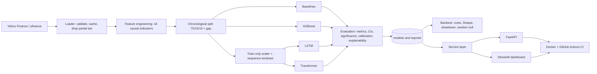

# Architecture

## Data flow (Mermaid, renders on GitHub)

## Design principles

1. **Leakage is a first-class concern.** Every stage that could leak (features, splitting, scaling, tuning, calibration,
   backtest timing) has an explicit rule and automated tests.
2. **One shared evaluation path.** Every model is scored by the same functions on the same test days, so tables are comparable.
3. **Signals as data.** Training runs save predictions to CSV; the backtester never imports model code.
4. **Framework-free service layer.** Business logic (`src/serving`) is independent of FastAPI/Streamlit, so it is unit-testable
   and shared by the API and the dashboard.
5. **Honest by construction.** Prediction responses carry held-out evidence, warnings and a disclaimer, never a bare "confidence".
6. **Reproducible.** Frozen data snapshot, fixed seeds, recorded test periods and a mismatch warning in the comparison.

## Key modules

| Area | Modules |
|---|---|
| Data | `src/data/loader.py`, `splits.py`, `statistics.py`, `synthetic.py` |
| Features | `src/features/indicators.py`, `engineering.py`, `preprocessing.py` |
| Models | `src/models/baselines.py`, `xgb_models.py`, `lstm.py`, `transformer.py`, `factory.py`, `calibration.py` |
| Training | `src/training/train_xgboost.py`, `train_deep.py`, `nn_trainer.py`, `sequences.py`, `tuning*.py` |
| Evaluation | `src/evaluation/metrics.py`, `stats.py`, `reporting.py`, `explain.py`, `permutation.py`, `compare.py` |
| Backtesting | `src/backtesting/engine.py`, `metrics.py`, `signals.py`, `random_baseline.py`, `runner.py` |
| Serving | `src/serving/service.py`, `jobs.py`, `deep_inference.py`, `bootstrap.py`; `api/`; `app/` |
